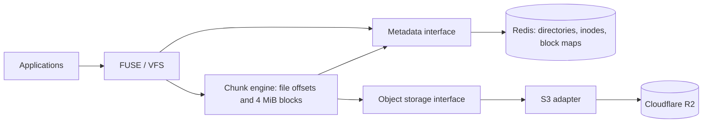

# Distributed File System

A Go FUSE filesystem with Redis metadata and Cloudflare R2 content storage.
Development starts with one mounted client; additional clients come later.
Metadata and object providers are replaceable adapters.



Files use immutable blocks of up to 4 MiB. Partial overwrites read and rewrite
only affected blocks. Sparse holes consume no objects. Writes upload blocks
before Redis atomically commits their mappings and file size. Writes and `fsync`
are synchronous; superseded blocks are reclaimed after replacements commit.

Supports directories, offset reads/writes, append, truncate, permissions,
timestamps, rename, unlink, and file/directory `fsync`. Open files survive rename
and unlink. Paths live in Redis; R2 keys use opaque IDs under
`volumes/<volume-id>/blocks/`.

## Run in Docker

Run these commands from the repository root. Docker builds the Go executable and
mounts the filesystem automatically when the `dfs` container starts.

1. **Start Docker.** On macOS, install and open
   [Docker Desktop](https://docs.docker.com/desktop/setup/install/mac-install/).
   The engine must provide `/dev/fuse`; Compose supplies the device and mount
   capability. Host Go and macFUSE are unnecessary for this Docker setup.

   ```sh
   docker compose version
   ```

2. **Configure R2.** Confirm that bucket `ffs` exists. In the
   [Cloudflare R2 dashboard](https://developers.cloudflare.com/r2/api/tokens/),
   open **Manage API Tokens**, create a token with **Object Read & Write** access
   scoped to `ffs`, and copy its **Access Key ID** and **Secret Access Key**.
   On first setup, create the local configuration:

   ```sh
   cp .env.example .env
   ```

   Fill in `R2_ACCESS_KEY_ID` and `R2_SECRET_ACCESS_KEY` in `.env`. Keep the supplied
   endpoint, bucket `ffs`, and region `auto`. The endpoint ends in
   `.r2.cloudflarestorage.com`, without `/ffs`. Compose reads `.env` automatically;
   Git and image builds exclude it.

3. **Build, start, and mount.** Redis starts first, then `dfs` connects to Redis
   and R2 and mounts at `/app/mnt` inside the container.

   ```sh
   docker compose up -d --build --wait
   docker compose ps
   docker compose exec dfs mountpoint /app/mnt
   ```

   Both services should be healthy, and the last command should print
   `/app/mnt is a mountpoint`. No separate mount command is needed.

4. **Write and read a file through the mount.**

   ```sh
   docker compose exec dfs mkdir -p /app/mnt/docs
   docker compose exec dfs sh -c 'printf "hello\n" > /app/mnt/docs/hello.txt'
   docker compose exec dfs cat /app/mnt/docs/hello.txt
   ```

   The output should be `hello`. For an interactive container shell, use
   `docker compose exec dfs sh`. The mount is available inside the container;
   to mount at `./mnt` on your Mac, follow the native instructions below.

5. **Unmount, stop, and check persistence.** Exit container shells first. Stopping
   the stack asks `dfs` to unmount and close its engines.

   ```sh
   docker compose down
   docker compose up -d --wait
   docker compose exec dfs cat /app/mnt/docs/hello.txt
   ```

   The file should still contain `hello`. `docker compose down` retains the data;
   the `-v` option removes the Redis metadata volume, so omit it when keeping files.

If startup fails, inspect `docker compose logs --tail=100 dfs redis`. Check that
Docker is running, `/dev/fuse` is available, and the R2 S3 credentials have access
to `ffs`. A volume configuration mismatch requires its original settings or a
fresh backing directory.

### Where data lives

| Component | Location |
| --- | --- |
| Mounted filesystem | `/app/mnt` inside `dfs` |
| Volume identity | `./data/r2-volume/volume.json` on the host |
| Directories, attributes, and block mappings | Compose `redis-data` volume |
| File contents | R2 bucket `ffs`, under `volumes/<volume-id>/blocks/` |

Redis uses AOF, `appendfsync always`, and `noeviction`; startup checks these
settings. Keep the manifest, Redis metadata, and R2 content together when backing
up or restoring. Previous disk-backed data remains under `./data/redis-volume`;
changing providers does not migrate it.

## Build and run natively

Requires Go 1.26+ and [macFUSE](https://macfuse.github.io/) on macOS, or FUSE on Linux.

```sh
go build -o bin/dfs ./cmd/dfs
docker compose up -d --wait redis
set -a
. ./.env
set +a
./bin/dfs -data ./data/native-r2
```

The mountpoint defaults to `./mnt`; pass another path as the final argument.
Ctrl+C unmounts. Flags override environment values:

| Flag | Environment | Default |
| --- | --- | --- |
| `-storage` | `DFS_STORAGE` | `s3` |
| `-redis-url` | `DFS_REDIS_URL` | `redis://127.0.0.1:16379/0` |
| `-s3-endpoint` | `R2_ENDPOINT` | Account endpoint from `.env.example` |
| `-s3-bucket` | `R2_BUCKET` | `ffs` |
| `-s3-region` | `R2_REGION` | `auto` |

Credentials use `R2_ACCESS_KEY_ID` and `R2_SECRET_ACCESS_KEY`, with AWS environment
names as fallbacks. An endpoint excludes the bucket path. Other S3 providers can
use their own endpoint and region. Use `-storage disk` for local disk storage.
The manifest binds each volume to its provider, bucket, and Redis namespace;
configuration mismatches and missing metadata stop startup before cleanup.

## Project layout

```text
cmd/dfs/                 Thin mount command
internal/app/            Provider composition, volume identity, mount lifecycle
internal/vfs/            Filesystem operations
internal/chunk/          Immutable blocks, offset IO, truncation, cleanup
internal/metadata/       Namespace and content-layout contracts
  redis/                 Redis transactions and block mappings
  bolt/                  Embedded reference adapter for offline tests
  redistest/             Isolated real-Redis test namespaces
internal/storage/        File and object storage contracts
  s3/                    S3-compatible object adapter, including R2
  disk/                  Local file adapter
  memory/                Volatile file/object adapters for tests
test/                    Adapter contracts, filesystem and mount integration tests
  s3test/                S3 HTTP fixture using the real AWS SDK
```

## Tests

```sh
go test -race ./...
go vet ./...
golangci-lint run --no-config ./...

# Real Redis and kernel FUSE inside Docker; no R2 credentials needed.
docker compose run --rm --build test
```

Native tests skip Redis unless `DFS_REDIS_TEST_URL` is set, and mounted tests
require `DFS_MOUNT_TEST=1`. S3 tests exercise signed SDK requests through an HTTP
fixture. For the optional live R2 test, set `DFS_R2_TEST=1`, R2 credentials, and
`DFS_REDIS_TEST_URL`, then run `go test -race ./test -run '^TestR2Filesystem$'`.

## Current limits

This implements a POSIX-style subset. Links, ownership changes, extended
attributes, file locking, and coordination between mounted clients remain future
work. The local volume lock permits one owner per backing directory; it is not
a distributed lease.

Startup checks live block references before reclaiming abandoned files. Objects
uploaded before a failed or interrupted metadata commit are retained for safety;
an object-level orphan collector is still needed. Redis is required to interpret
R2 blocks. Always change files through the mount.
