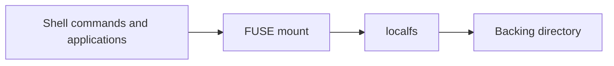

# Distributed File System

A single-process, disk-backed FUSE filesystem in Go. Files and metadata live in
a local backing directory, exposed through a mount that ordinary commands can
use. This is the first milestone toward a distributed filesystem.



Supports files and directories, offset reads/writes, append, truncate, permissions,
timestamps, rename, deletion, and file/directory `fsync`. Open file descriptors
remain valid after rename or unlink. Files and metadata persist in the backing
filesystem across restarts.

## Run

### Docker

Run the filesystem inside Docker's Linux environment, with no macFUSE
installation needed on your Mac:

```sh
docker compose up --build --wait
docker compose exec singlefs sh
```

In that container shell:

```sh
mkdir -p /app/mnt/docs
printf 'hello\n' > /app/mnt/docs/hello.txt
cat /app/mnt/docs/hello.txt
exit
```

Stop and restart from your Mac:

```sh
docker compose down
docker compose up --wait
docker compose exec singlefs cat /app/mnt/docs/hello.txt
```

The mount exists at `/app/mnt` inside the container. Your Mac's `./data` is
bind-mounted as the persistent backing directory; `docker compose down` keeps
its contents. Your Mac's `./mnt` remains an ordinary directory. Use the container
shell for filesystem operations while it is running.

The Docker engine's Linux environment must provide `/dev/fuse`. Compose grants
the device and mount capability, and relaxes AppArmor for mount operations.
The image build runs the callback tests and vet before compiling the executable.

### Native

Requires Go 1.25+ and a FUSE driver:

- macOS: install [macFUSE](https://macfuse.github.io/) and complete its OS setup.
- Linux: enable `/dev/fuse` and install `fusermount` or `fusermount3`.

```sh
go run ./cmd/singlefs
```

The defaults are `./data` for storage and `./mnt` for the mountpoint, relative
to the current working directory. The command creates the mountpoint if needed;
it must be empty and separate from the backing directory. The command stays in
the foreground while the filesystem is mounted.

Override either path when needed:

```sh
go run ./cmd/singlefs -data ./other-data ./other-mount
```

In another terminal:

```sh
mkdir mnt/docs
printf 'hello\n' > mnt/docs/hello.txt
cat mnt/docs/hello.txt
mv mnt/docs/hello.txt mnt/docs/saved.txt
```

Press Ctrl+C in the mount process to unmount, then run the same mount command
again and check persistence:

```sh
cat mnt/docs/saved.txt
```

External `umount ./mnt` also stops the process. Close open files if unmount
reports that the filesystem is busy.

## Layout and checks

```text
cmd/singlefs/      Mount command and argument tests
internal/localfs/  Filesystem operations and FUSE integration
test/              Filesystem behavior and optional mounted smoke tests
Dockerfile         Tested Linux build and FUSE runtime image
compose.yaml       Container mount, persistent storage, and health check
```

```sh
go test -race ./...
go vet ./...
# Optional, with golangci-lint installed:
golangci-lint run --no-config ./...
# With a FUSE driver installed:
DFS_MOUNT_TEST=1 go test -race -run '^TestMountedFilesystem$' ./test
```

The regular suite tests callbacks without mounting, including restart persistence,
concurrent append, rename/unlink with open descriptors, and directory pagination.
The opt-in smoke test mounts, writes, unmounts, mounts again, and reads the file.
It is skipped unless `DFS_MOUNT_TEST=1`; callback tests alone do not verify a
working kernel mount.

## Current limits

This is a single-user POSIX-style subset. Links, ownership changes, extended
attributes, file locking, and full POSIX compliance are outside this first version.
One process owns a backing directory at a time; change its contents through the
mount while running. Inode metadata is cached until unmount. Data durability is
provided by the host filesystem through `fsync`; replication comes later.
