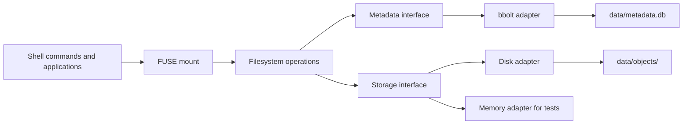

# Distributed File System

A distributed filesystem project in Go, starting with one client for testing
before adding distributed operation. The FUSE client coordinates a metadata engine
and a content storage engine, exposed through a mount that ordinary commands can use.
Both engines currently persist locally under the backing directory.



Supports files and directories, offset reads/writes, append, truncate, permissions,
timestamps, rename, deletion, and file/directory `fsync`. Open file descriptors
remain valid after rename or unlink. Files and metadata persist in the backing
filesystem across restarts.

## Run

### Docker

Run the filesystem inside Docker's Linux environment, with no macFUSE
installation needed on your Mac:

```sh
docker compose up --build --wait
docker compose exec dfs sh
```

In that container shell:

```sh
mkdir -p /app/mnt/docs
printf 'hello\n' > /app/mnt/docs/hello.txt
cat /app/mnt/docs/hello.txt
exit
```

Stop and restart from your Mac:

```sh
docker compose down
docker compose up --wait
docker compose exec dfs cat /app/mnt/docs/hello.txt
```

The mount exists at `/app/mnt` inside the container. Your Mac's `./data` is
bind-mounted as the persistent backing directory; `docker compose down` keeps
its contents. Your Mac's `./mnt` remains an ordinary directory. Use the container
shell for filesystem operations while it is running.

The Docker engine's Linux environment must provide `/dev/fuse`. Compose grants
the device and mount capability, and relaxes AppArmor for mount operations.
The image build runs the callback tests and vet before compiling the executable.

### Native

Requires Go 1.25+ and a FUSE driver:

- macOS: install [macFUSE](https://macfuse.github.io/) and complete its OS setup.
- Linux: enable `/dev/fuse` and install `fusermount` or `fusermount3`.

```sh
go run ./cmd/dfs
```

The defaults are `./data` for storage and `./mnt` for the mountpoint, relative
to the current working directory. The command creates the mountpoint if needed;
it must be empty and separate from the backing directory. The command stays in
the foreground while the filesystem is mounted.

Override either path when needed:

```sh
go run ./cmd/dfs -data ./other-data ./other-mount
```

In another terminal:

```sh
mkdir mnt/docs
printf 'hello\n' > mnt/docs/hello.txt
cat mnt/docs/hello.txt
mv mnt/docs/hello.txt mnt/docs/saved.txt
```

Press Ctrl+C in the mount process to unmount, then run the same mount command
again and check persistence:

```sh
cat mnt/docs/saved.txt
```

External `umount ./mnt` also stops the process. Close open files if unmount
reports that the filesystem is busy.

## Layout and checks

```text
cmd/dfs/           Mount command and argument tests
internal/app/      Provider selection, local resources, and mounting
internal/vfs/      Filesystem operations, engine coordination, and FUSE integration
internal/metadata/ Metadata contract, types, and errors
  bolt/            Transactional bbolt adapter
internal/storage/  Content contract and optional capacity reporting
  disk/            Disk adapter with platform-specific capacity reporting
  memory/          Volatile sparse-content adapter
test/              Filesystem behavior and optional mounted smoke tests
Dockerfile         Tested Linux build and FUSE runtime image
compose.yaml       Container mount, persistent storage, and health check
```

VFS receives its adapters through constructor injection:

```go
files, err := vfs.New(vfs.Config{
    Metadata: metadataAdapter,
    Storage:  storageAdapter,
})
```

Use `app.MountFS(files, mountpoint)` to mount a composed filesystem; it takes
ownership and closes the filesystem if mounting fails or the connection ends.
`internal/app` wires bbolt and disk storage for the CLI. Implement the engine
interfaces to add a provider, or wrap an existing adapter to add behavior. Storage
uses portable access modes; VFS translates engine errors into FUSE errors.
Construction transfers ownership only on success: `files.Close()` closes both
engines and then an optional `Release` callback. On failure, the caller closes them.
The pair must exclusively own the same filesystem and a dedicated object namespace;
changing providers requires migrating their data. Memory storage is for isolated
tests with fresh metadata. Shared contract suites exercise storage and metadata
adapters; add new providers to their factory maps to run the same checks.

```sh
go test -race ./...
go vet ./...
# Optional, with golangci-lint installed:
golangci-lint run --no-config ./...
# With a FUSE driver installed:
DFS_MOUNT_TEST=1 go test -race -run '^TestMounted' ./test
```

The regular suite tests both engines and filesystem callbacks without mounting,
including restart persistence, process-exit recovery, failed-commit retries,
concurrent append, rename/unlink with open descriptors, and directory pagination.
The opt-in mount tests verify default-provider persistence and a composed mount
with memory storage. They are skipped unless `DFS_MOUNT_TEST=1`; callback tests alone do not verify a
working kernel mount.

## Current limits

The current implementation supports a POSIX-style subset. Links, ownership changes,
extended attributes, file locking, and full POSIX compliance are outside this first version.
One process owns a backing directory at a time; use the mount to change files.
File contents are synced before size metadata is committed. Namespace mutations
use durable database transactions. Startup reclaims abandoned content objects and
unlinked inodes, and reconciles sizes after interrupted writes. Replication and
coordination between clients come later.

The backing directory contains `metadata.db` and `objects/`; mounted file names
exist only in metadata. Rename changes metadata without moving content. Unlinked
files retain their content until the final open handle closes. An unformatted
backing directory must be empty. For data from the earlier directory-backed
prototype, choose a new `-data` directory and copy files through the mount;
existing files are never automatically migrated or deleted.
