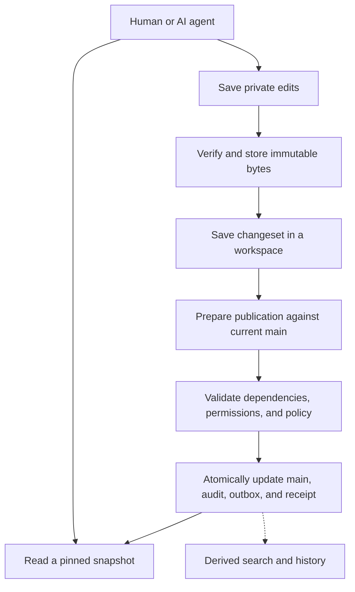

# agentfs

A versioned workspace for documents and artifacts shared by humans and AI
agents. Save progress in a private workspace, then publish validated changes
atomically to a shared `main` within each space.

The Go implementation provides snapshot reads, conditional file operations,
publication coordination, and working-copy synchronization. Storage adapters,
HTTP/MCP transports, and background workers are still to be implemented.



The diagram shows the intended service flow. Saving keeps work recoverable;
publishing makes it shared. Conflicts preserve the saved proposal for resolution.

```text
cmd/api/             HTTP server entry point location (planned)
cmd/worker/          Background worker entry point location (planned)
internal/workspace/  Workspace domain, services, contracts, and colocated tests
api/                Transport specifications (planned)
migrations/         Database migrations (planned)
testdata/           Test and audit fixtures
docs/               Architecture, domain reference, and reviews
```

Run checks from the repository root with Go 1.22+ and golangci-lint v2.15.0:

```sh
go test -race ./...
go vet ./...
golangci-lint run ./...
```

The module currently uses only the standard library, so it has no `go.sum`.
See the [architecture](docs/ARCHITECTURE.md), [domain reference](docs/WORKSPACE.md),
and [design](docs/DESIGN.md) for details.
