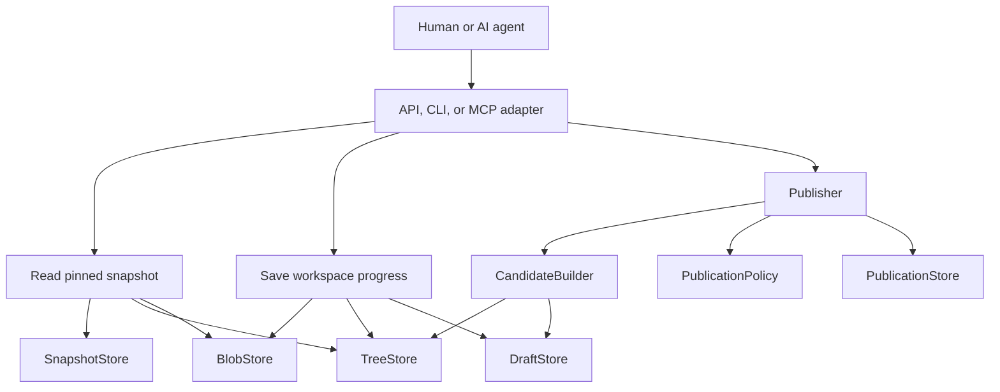
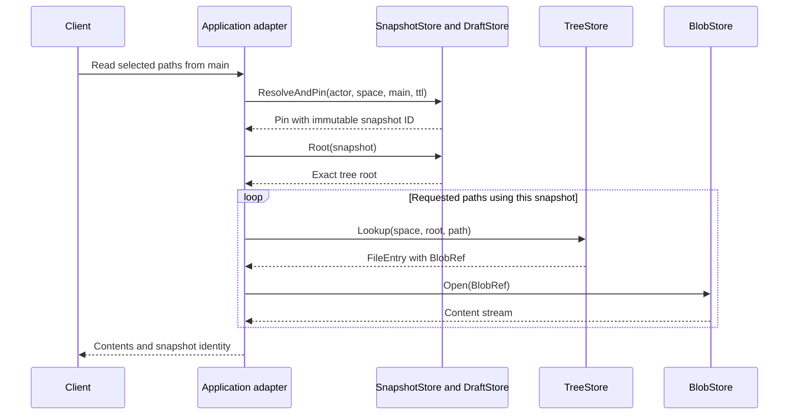
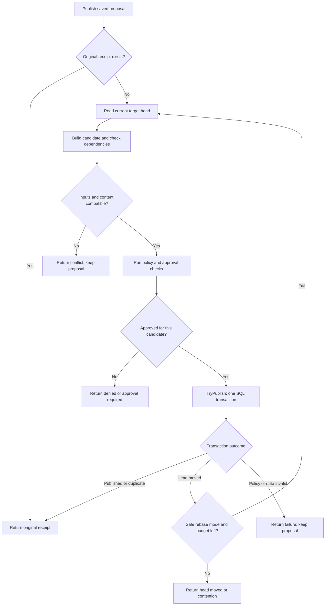
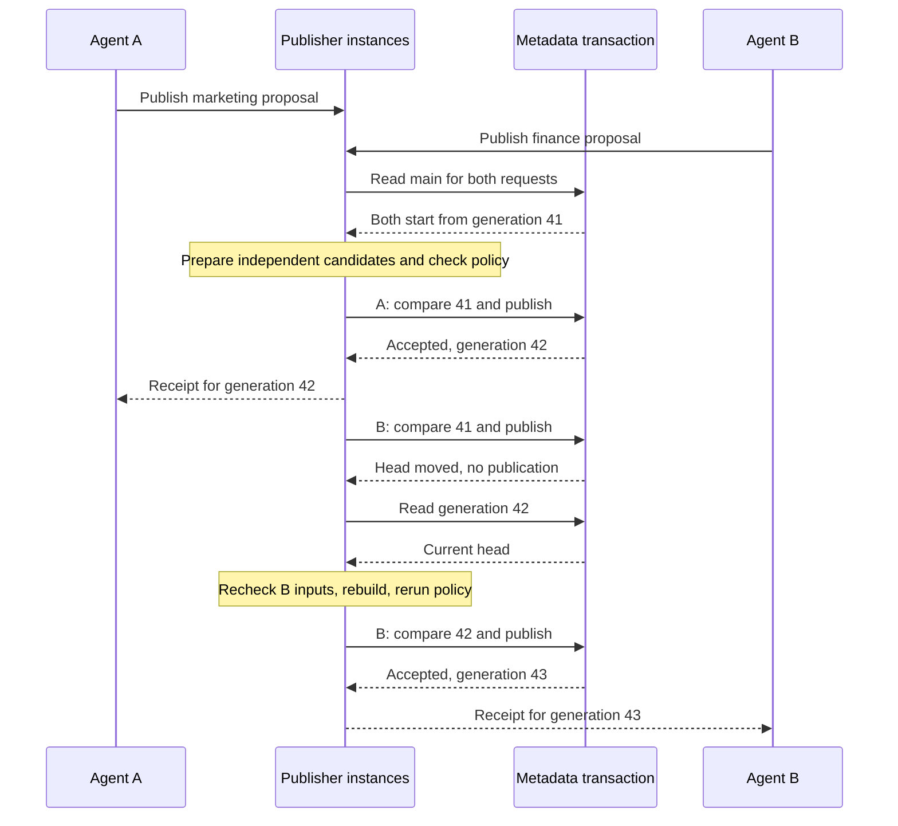
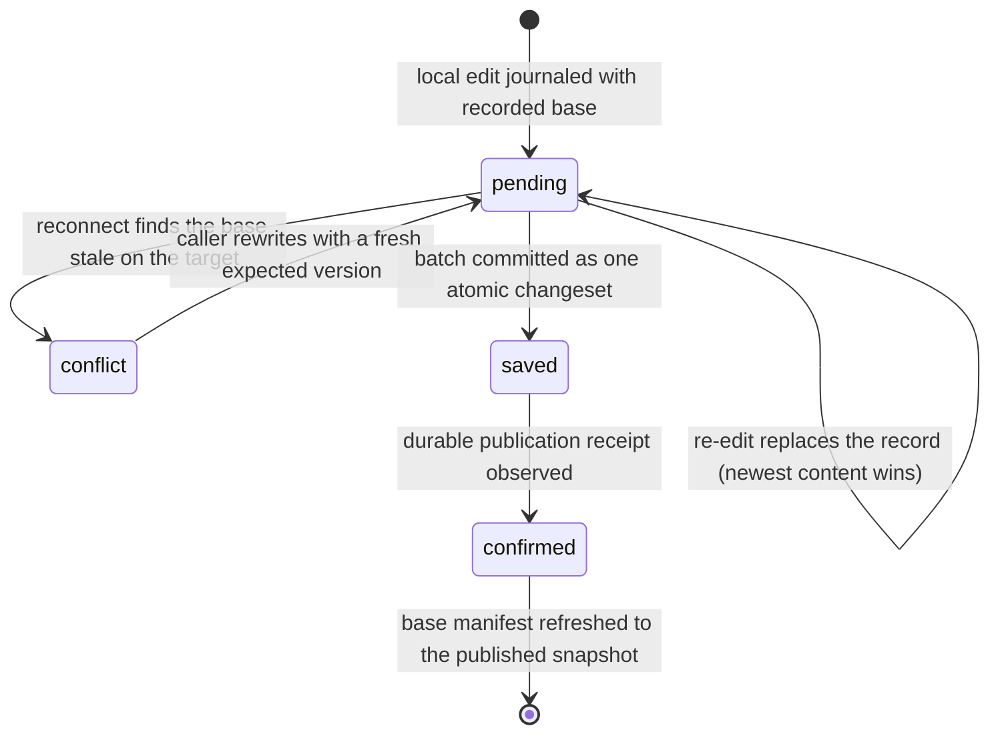

# How the Go abstractions fit together

There are three different operations: **read a stable version**, **save work**, and **publish work**. Saving makes progress recoverable without changing the shared `main` ref. Publishing makes a validated result authoritative.

These diagrams describe the intended adapter interactions. The Go module currently implements the `Publisher` coordinator; the storage and policy components are interfaces.

## 1. System overview



| Component | What it owns | What happens there |
|---|---|---|
| API/CLI/MCP adapter | Authentication and request lifecycle | Establish trusted identity, authorize requested paths, pass context/deadlines, translate errors. All transports share the same application services. |
| `BlobStore` | File bytes | Verify full digest/size and store immutable bytes. A PDF or Markdown file is just content here. |
| `TreeStore` | Snapshot path lookup and file identity | Map `reports/q3.md` to a stable `FileID` plus blob; create a new root by reusing unchanged nodes. Identity rules: edits preserve the FileID, moves preserve it, copies and delete-then-recreate mint new ones. |
| `DraftStore` | Saved deltas and workspace heads | Persist intent, attribution, changes, dependencies, derived-root association, and retention protection. |
| `SnapshotStore` | Consistent read handles and retention pins | Resolve `main` once and protect that immutable version against collection. |
| `CandidateBuilder` | Preparing a proposed publication | Check expected file versions and input dependencies against the current head; rebase the delta onto that head; save a readable, retained candidate. |
| `PublicationPolicy` | Expensive checks before publication | Validate document schemas, inspect approvals, and return evidence for one exact candidate. |
| `PublicationStore` | The atomic shared-state update | Compare head/generation, enforce current policy/ACLs, update the ref, and persist audit/outbox/receipt together. |
| `Publisher` | Coordination | Invoke the three publication components, retry only supported races, and return the accepted result. |
| `FileService` | Filesystem-facing operations | `ReadFile`/`Stat`/`List`/`WriteFile`/`Move`/`Copy`/`Delete`/`Commit` over the core ports: verified staging, mandatory preconditions, atomic multi-file changesets, snapshot-consistent reads. |
| `WorkingCopyManager`, `SyncJournal`, `LocalCache` | Local copies | A local directory backed by a pinned snapshot: evictable cached content, durable unpublished edits, and a durable sync journal with recorded base versions. |
| `SearchIndex`, `FileMetaStore` | Derived read models | Filename/full-text hits and FileID history: identity, path, matching snapshot, snippets, freshness — authorization applied before exposure. |
| `CapabilityDiscoverer` | Contract negotiation | Which guarantees are enforced (conditional writes, stable IDs, snapshots, atomic commits, watching) and the transfer limits. Unsupported features fail explicitly. |

## 2. Read a stable snapshot



The adapter checks current permissions before exposing paths or bytes. Storage ports are internal; a caller cannot bypass authorization by presenting a blob digest.

Resolving `main` separately for each file could mix versions. A single snapshot ID prevents that. The retention pin additionally prevents GC from deleting its reachable objects while the pin is live. Pagination uses the same root and a cursor bound to that root.

The diagram uses individual lookups for clarity. A production adapter should batch independent metadata lookups and bound parallel blob fetches; its in-flight work must fit request limits and stop on context cancellation.

## 3. Save work without publishing

```mermaid
sequenceDiagram
    participant C as Agent
    participant A as Application adapter
    participant B as BlobStore
    participant T as TreeStore
    participant D as DraftStore
    C->>A: Save edits to a workspace
    A->>B: Put(expected digest and size, bytes)
    B-->>A: Verified immutable BlobRef
    Note over A,D: Ingest registers verified bytes and retention
    A->>D: Root(workspace head snapshot)
    D-->>A: Base tree root
    A->>T: Apply(base root, mutations with old values)
    alt Old value or path conflicts
        T-->>A: Structured conflict
        A-->>C: Conflict details; no shared ref changes
    else Valid delta
        T-->>A: New immutable tree root
        A->>D: Save(operation, workspace generation, changeset, root)
        D-->>A: Saved workspace head and generation
        A-->>C: Saved changeset ID
    end
```

`Save` atomically records the changeset, workspace CAS result, retention root, audit/outbox entries, and idempotency result. A crash before this point may leave unreferenced uploads or tree nodes for later collection. It cannot expose a partially updated `main`.

The old value of every changed path is explicit. Creating a file expects absence; replacing/deleting expects a particular content digest. The agent also records read dependencies: for example, a forecast may depend on a particular `pricing.json` version even though it writes a different file.

Workspace heads use CAS too. Two calls modifying the same private workspace must not silently overwrite each other. Different workspaces save independently.

## 4. Publish a saved proposal



Strict mode also checks the caller’s exact expected head/generation before preparation and again atomically at publication. Every retry that prepares a new candidate also obtains new policy evidence. A permit for an older candidate cannot approve a different result.

`CandidateBuilder.Prepare` does expensive work before any shared metadata write lock is held. The final transaction still rechecks the exact head, current permissions, policy revision, and retained verified objects. If any required invariant changed, it fails without moving the ref.

### Inside the atomic transaction

| Order | Action | Why it belongs in the transaction |
|---|---|---|
| 1 | Look up the operation key and request fingerprint. | Concurrent duplicate requests must converge on the same receipt; different requests cannot reuse the key. |
| 2 | Compare current ref head **and generation** to the prepared base. | Another writer may have moved the ref, including away and back. |
| 3 | Validate candidate scope, parent, derived-root readiness, blob registrations, and retention state. | A published snapshot must have readable, retained inputs. |
| 4 | Enforce current ACLs, policy evidence/revision, and any fencing epochs. | Preparation-time permission checks may have become stale. |
| 5 | Move the ref and increment its generation. | This is the shared-state mutation. |
| 6 | Persist audit record, outbox event, and idempotency receipt. | Publication and its evidence must succeed or fail together. |
| 7 | Commit under the configured durability policy. | Only then acknowledge publication. |

The outbox dispatcher runs later. Delivery can repeat, so consumers deduplicate events. There is no separate request-time call to a message broker between moving the ref and saving the receipt.

## 5. Two agents publishing concurrently



This succeeds only if B’s recorded dependencies still match. If B read a pricing file that A changed, B receives `ErrDependencyChanged` and must recompute or resolve it. The coordinator itself does not guess semantic independence; the builder validates it.

Several Publisher instances can run in different Go processes. They share no mutex. The metadata transaction supplies the common ordering point. Goroutines let request I/O and preparation overlap; database CAS decides which candidate becomes the next shared state.

## 6. Failure and retry behavior

| Situation | Result |
|---|---|
| Upload succeeds, save fails | Unreferenced immutable data may remain; no published state changes. |
| Workspace head moved while saving | Save fails its workspace CAS; caller retries or branches. |
| Shared head moves during preparation | Safe mode retries within budget; strict mode reports head movement. |
| Declared input or content conflicts | Structured conflict; saved proposal remains available. |
| Approval is missing | Explicit approval-required error; no publication. |
| Policy changes after evaluation | Transaction rejects stale evidence. |
| Publication succeeds, response is lost | Same request/key retrieves the original durable receipt. |
| Two copies of one request arrive together | One publication and one logical outbox event; both get the same receipt. |
| Same key is reused for different content | Idempotency conflict. |
| Request is canceled near commit | Outcome may be uncertain; retry the same request/key. |
| Another writer keeps winning | Retry budget ends with contention instead of an infinite loop. |

Leases, journals, regional cache tiers, format-specific merges, and external API transports can be added after these core contracts have real adapters and tests against the chosen database/object backend.

## 7. Filesystem operations and stable identity

`FileService` gives every transport (REST, CLI, MCP, future mount) the same familiar operations with the same rules:

- **Every replacement write names the version it replaces; every creation declares expected absence.** A nil expectation is rejected (`ErrPreconditionRequired`) — an adapter never silently drops a precondition.
- **Related edits travel together**: `Commit` records several mutations as ONE atomic changeset, so no reader of any snapshot observes a partial group.
- **Stable identity**: the tree layer mints a `FileID` when a path gains a file that had none, and preserves it across content edits and moves. Comments, references, and logical history attach to the FileID via the derived `FileMetaStore`; a blob digest identifies exact bytes, a FileID identifies the document.

```mermaid
sequenceDiagram
    participant C as Client (any transport)
    participant F as FileService
    participant A as Authorizer
    participant B as BlobStore
    participant T as TreeStore
    participant D as DraftStore
    C->>F: WriteFile(path, expected, bytes) or Commit(ops)
    F->>A: CheckAccess per affected path
    F->>B: Stage: verify digest and size, store immutable bytes
    F->>D: Workspace head snapshot
    F->>T: Apply(base root, mutations with expected old values)
    alt Precondition or dependency mismatch
        T-->>F: Structured conflict (path, expected, actual)
        F-->>C: Conflict; no shared ref moved, workspace unchanged
    else Valid delta
        T-->>F: New root (FileIDs preserved or minted by rule)
        F->>D: Save changeset atomically (idempotency key)
        F-->>C: Saved workspace head — publication is a separate call
    end
```

## 8. Working copy: checkout and synchronization

A working copy is a local directory backed by a pinned remote snapshot. The journal distinguishes three kinds of local state: **evictable cached content** (re-fetchable from the base snapshot), **durable unpublished edits** (never evicted), and the **durable sync journal** (recorded base versions plus pending operations, written before any remote interaction).

Local moves require paths without overlapping unconfirmed journal entries;
publish or resolve those edits first. A move records intent before copying
cached bytes and removes the source only after a successful destination write.
Cache and journal errors reach the caller; an error after intent is recorded
leaves a pending move that can be retried or synchronized. Retrying a saved move
returns its existing journal entry and preserves its batch identity.



Synchronization is crash-safe because every transition is journaled and every batch is idempotent:

1. **Reconnect conflict detection.** Pending entries are compared to the CURRENT head of the target using their recorded bases; stale entries become conflicts and are preserved untouched.
2. **Verified staging.** Clean content uploads with bounded concurrency; each success is journaled immediately, so a crash mid-pass leaves retryable state.
3. **Atomic save.** All clean edits commit as ONE changeset under a deterministic idempotency key derived from the entries; a retry rebuilds the identical request and replays the original save.
4. **Publication.** The workspace head publishes through the Publisher with the same key: a lost response replays the original receipt instead of publishing again. Only then do entries become confirmed and the base manifest refresh.

```mermaid
sequenceDiagram
    participant L as Local copy
    participant J as Sync journal
    participant S as Sync
    participant P as Publisher
    L->>J: Journal edit (base version recorded first)
    Note over L: crash — journal and cache survive
    L->>S: Sync (fresh process, same journal)
    S->>J: Read pending entries and recorded bases
    S->>S: Stage content (bounded), journal each success
    S->>S: Commit one atomic changeset (deterministic key)
    S->>P: Publish proposal (same key)
    alt Publication already committed before the crash
        P-->>S: Original receipt (replayed)
    else Fresh publication
        P-->>S: Receipt
    end
    S->>J: Entries confirmed; base manifest refreshed
```

## 9. Capabilities and derived read models

Adapters discover the enforced contract before use: `Capabilities` reports conditional writes, stable IDs, snapshots, atomic multi-file commits, watching (polling vs. resumable subscriptions are distinct capabilities), search modes, and transfer limits. Requesting an unsupported guarantee returns `ErrUnsupportedCapability` — the service refuses to start over a backend that cannot enforce the core guarantees rather than downgrade them silently.

`SearchIndex` and `FileMetaStore` are derived views, rebuildable from the outbox:

- Results carry file identity, path, matching version/snapshot, snippets, and a freshness watermark with a lag flag.
- Current authorization applies to indexed, cached, and historical results alike (`AuthorizedSearchIndex` is the reference wrapper); a content hash is never an access credential.
- Ingest is at-least-once from committed outbox events, so `Apply` is idempotent per event ID.

## 10. Future boundary: document sessions

`DocumentSession` is the future live-collaboration boundary for supported formats. It separates ephemeral presence, live editing state (never authoritative), and durable content; sessions checkpoint through the ordinary save path and must detect external writes by comparing the durable version to the session base. v1 returns `ErrUnsupportedCapability` for sessions rather than approximating live collaboration with polling writes.
