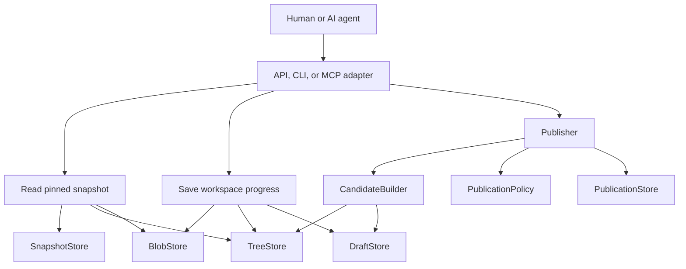
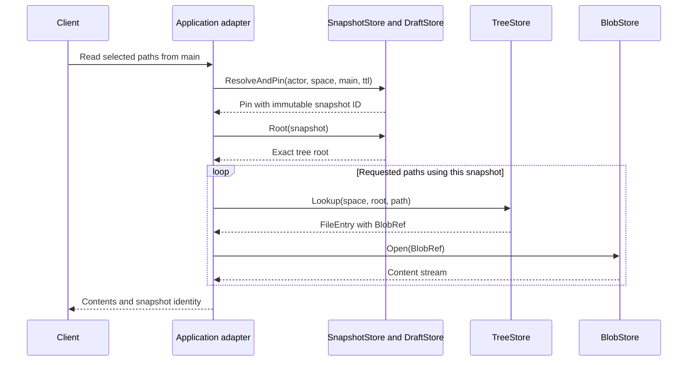
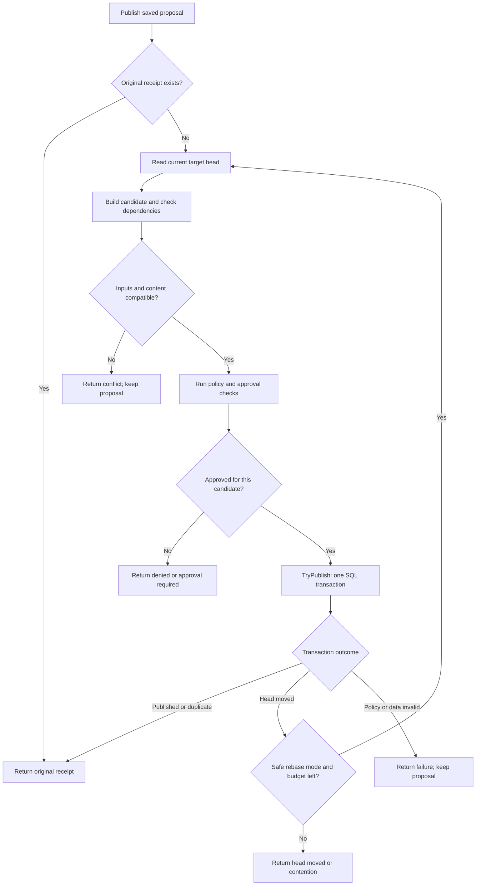

# Design Doc: Org-Wide Distributed File System for Humans + AI Agents

Status: **v2 — incorporates the 2026-11-24 design review** (`docs/reviews/2026-11-24-design-review.md`) and aligns with the reference abstractions in `go/agentfs/`.
v1 draft is preserved unchanged at `docs/DESIGN-v1.md`.
Date: 2026-11-24

---

## 1. Summary

An online, versioned organizational workspace with distributed storage. It is the **ground truth** for documents and artifacts across every team, consumed by two user classes:

1. **Humans** — CLI, web UI, and existing S3-compatible tools.
2. **AI agents** — a first-class MCP/API surface, expected to become the dominant consumer.

The central organizing rule (v2, from the review):

> **Saving immutable changes is independent of publishing them to shared state.**

- *Save* records progress as an immutable **changeset** in a private **workspace** — recoverable, attributable, without touching any shared ref.
- *Publish* moves a shared ref (`main`) in **one atomic metadata transaction**, validating preconditions, dependencies, policy, and permissions at that moment.

Ordinary work is proportional to files changed or requested — never to namespace size.

The data plane is S3-compatible object storage holding verified immutable bytes; a transactional metadata layer (authoritative SQL) owns refs, changesets, trees-as-derived-views, and the publication linearization point. The core problems — versioning and concurrent reads/writes — are solved by snapshot isolation for readers, CAS-with-generation for writers, and declared read dependencies for detecting stale assumptions.

---

## 2. Background & Motivation

- Agents are org-wide tools now, not engineering-only. Every team's agents need to produce and consume shared documents.
- Today's cross-team exchange (chat, email, ad-hoc shares) gives agents no machine-readable source of truth — they stale-copy, duplicate, or hallucinate.
- Agents collaborate with agents. A shared, versioned, observable workspace with explicit save/publish semantics turns ad-hoc chat collaboration into inspectable history.
- "Ground truth with freedom": one authoritative `main` **per space** (§3), while teams and agents work freely in private workspaces and branches.

### Why S3-compatible object storage (and its limits)

S3 gives us cheap durable capacity, immutable-PUT semantics for content addressing, conditional writes, presigned delegated access, lifecycle tooling, and backend portability (S3 / R2 / MinIO).

S3 does **not** give us: directory semantics, multi-file atomicity, conflict detection/merge, metadata queries, fine-grained authz, or events. All of that lives in the metadata layer — the heart of this design. Also note: S3 objects are **not inherently immutable** (ordinary writes can overwrite an existing key); we enforce immutability via conditional operations, create-only storage, and bucket policy, and qualify any alternative backend against that behavior ([AWS conditional writes](https://docs.aws.amazon.com/AmazonS3/latest/userguide/conditional-writes.html)).

### What the research adds (v2)

| System | Published design | What we take from it |
|---|---|---|
| Cursor Origin / Continuity — ["Git at any scale"](https://cursor.com/blog/git-at-any-scale) (Aug 2026) | Keeps Git; persists pushes in an S3 WAL, publishes via atomic index update; local repos are reconstructable caches; replicas check freshness against the authoritative index. | A clearly identified **durable publication point**; storage as caches, not authority. We do *not* transplant its S3 WAL/index as a second authority beside our SQL design. |
| Anthropic Scion — ["Redesigning source control"](https://www.anthropic.com/research/redesigning-source-control) (Oct 2026) | Server-created changesets with file deltas; changeset creation doesn't move a named ref; derived indexes serve history/queries; sparse server-side fetches and caches. | **Save ≠ publish**; derived views; sparse reads that move less data. Anthropic describes an unusual workload and does not position Scion as a general Git replacement. |

These are materially different architectures. v1's dismissal of Git ("single pack mutex") was too broad — see §15, reframed around workload fit.

---

## 3. Goals / Non-Goals

### Goals

- G1. Every mutation is a versioned, attributed changeset; every publication is atomic, auditable, and replayable.
- G2. Readers observe a **consistent snapshot across requests** (not just within one response), via explicit snapshot handles.
- G3. Concurrent writers never silently overwrite each other. Two failure classes are distinguished: **content conflicts** and **stale assumptions** (§7).
- G4. Save is cheap and private; publish is the only shared-state mutation. Independent work lands without artificial contention; dependencies are honored.
- G5. Agent-first API (MCP + REST): deterministic, self-describing, with structured, actionable errors.
- G6. Human compatibility: snapshot-bound S3 read gateway; local materialization for external tools.
- G7. Workload hypothesis: ~10³ users, ~10⁴ concurrent agents, ~10⁷–10⁹ files. **Treated as a hypothesis until benchmarked** (§14), not a claim.
- G8. Provable provenance: authenticated identity per write (human/agent/tool/run), audit for reads and writes, tamper-evident records.

### Non-Goals (v1)

- Real-time fine-grained co-editing (CRDT document editing) — possible per-doc-type add-on later.
- POSIX semantics (byte-range locks, mmap). Not a kernel filesystem.
- Replacing the data warehouse or CDN workloads.
- Cross-space atomic publication. Spaces are transaction boundaries; an org snapshot records `{space_id, changeset_id}` pairs but is not a globally simultaneous snapshot. A cross-space protocol is out of scope for v1.
- End-to-end encryption in v1 (room reserved; see §11).

---

## 4. Key Design Drivers

1. **Deterministic, inspectable concurrency.** Agents handle explicit structured errors (`HEAD_MOVED`, `CONTENT_CONFLICT`, `DEPENDENCY_CHANGED`) far better than hidden last-write-wins. Every response carries snapshot/ref identity.
2. **Save without coordination.** An agent must be able to save a 20-minute work session without competing for a shared ref. Publication contention affects only agents who *choose* to publish.
3. **Stale assumptions are not conflicts.** If agent B derived `forecast.md` from `pricing.json` and A changes `pricing.json`, B's write target is untouched — but B's output may be wrong. The API makes dependencies declarable and validates them at publish time (§7). The service cannot infer every fact an agent relied on; it validates what is declared.
4. **Fenced, expiring coordination.** Any exclusion mechanism (reservations) is TTL-based, returns a fencing epoch, and never bypasses publication validation. Crashed or paused writers lose authority automatically (etcd-style fencing).
5. **Event-driven coordination** via at-least-once outbox events that consumers deduplicate — verifiable against ground truth, never the only copy of truth.
6. **Immutable, content-addressed everything.** Snapshots and blobs are pinned by ID; "the spec as of yesterday 3pm" is a stable handle an agent can hold across a long task.

---

## 5. High-Level Architecture

Components correspond 1:1 to the Go contracts in `go/agentfs/` (`ports.go`). The module implements the `Publisher` coordinator; storage and policy components are interfaces awaiting adapters.



| Component | Owns | Contract (`go/agentfs/ports.go`) |
|---|---|---|
| API/CLI/MCP adapter | Identity, authz of requested paths, context/deadlines, error translation | establishes trusted `Principal` |
| `BlobStore` | File bytes | verify full digest/size, create-only immutable storage, space-scoped keys |
| `TreeStore` | Path→blob lookup at an exact root | `Apply` checks `Before` values, produces structurally shared roots; `Lookup` / `Fingerprint` / paginated `List` |
| `DraftStore` | Saved changesets, workspace heads, retention roots | atomic save of changeset + retention + audit/outbox + idempotency |
| `SnapshotStore` | Consistent read handles, retention pins | `ResolveAndPin` / `RenewPin` / `ReleasePin` |
| `CandidateBuilder` | Preparing a publication candidate | checks preconditions + dependencies against head; supported merges; saves a readable, retained candidate |
| `PublicationPolicy` | Expensive checks outside the transaction | schema validation, approvals; returns a `Permit` bound to actor/target/candidate/inputs/policy revision; `ErrApprovalRequired` rather than waiting |
| `PublicationStore` | The linearization point | `TryPublish`: one SQL transaction; `LookupPublication` for retry replay |
| `Publisher` | Coordination | validate → prepare → policy → TryPublish; bounded retries; original-receipt replay |

**Golden rules:**

- Data plane stores immutable content; metadata layer owns all mutable state.
- Clients never get storage credentials — only presigned staging URLs and mediated reads. Knowing a digest never grants access (`BlobRef` is space-scoped; `Open` is an internal trusted operation).
- The `Publisher` holds no process-wide locks and starts no goroutines; distributed correctness lives in `TryPublish`'s database transaction, not in any process mutex. Several Publisher instances run concurrently across processes.
- Slow work (merge, validation, approval) runs **outside** the publication transaction. The transaction re-checks everything (§6.3).

---

## 6. Core Model and the Three Operations

### 6.1 Data model

```text
Changeset {
  id, schema_version, space_id,
  parent: changeset_id,             // single-parent delta
  source: changeset_id?,            // original proposal if this is a rebased candidate
  delta: [Mutation{path, before: Version, after: BlobRef?}, ...],
  inputs: [Dependency{path, kind: file|subtree, expected: Version}, ...],
  author: {principal_id, owner_id, kind: human|agent|service, tool, run_id},
  message, created_at, provenance
}

Ref        { space_id, name, head_changeset_id, generation }   // generation defeats ABA
Workspace  { id, owner, space, base, head, generation, expires_at }
Snapshot   { space_id, changeset_id }        // + Pin{id, expires_at} for retention
BlobRegistration { security_domain, sha256, size, storage_key, verification_state, gc_state }
DerivedTree { changeset_id, index_format_version, root_hash, readiness }
```

Semantics (from `go/agentfs/model.go`):

- **`Version{Exists, Digest}`** represents a known value **or known absence**. Creating a file requires `Before.Exists == false`; replacing/deleting requires an exact expected digest. This makes "create" and "delete" races explicit instead of silent.
- **Changeset IDs** are computed from a versioned canonical serialization (implementation-defined; `json.Marshal` of the DTO is not the format). Server-assigned time and authenticated attribution are fixed once per idempotent request; user-supplied author strings never establish identity.
- **Refs carry a monotonic `generation`** alongside `head` so that a ref moving away and back (ABA) is still detected.
- **Workspaces** are private draft lineages with their own CAS generation and expiry; updating a workspace head never touches a shared ref. Different workspaces save independently.
- **Trees, path history, search, ancestry** are **derived views** over changesets. Their encoding can change without changing changeset IDs. Required lookup structures must be ready before a snapshot is returned as readable; optional indexes may catch up asynchronously.

### 6.2 Read a stable snapshot



Two separate calls with `ref=main` can resolve to different commits — `latest` is only linearizable when resolved against the authoritative metadata primary (or a replica proven to meet the freshness boundary). **One snapshot ID across related reads and paginated listings is mandatory** for a consistent multi-file view.

- The **retention pin** protects the snapshot's reachable objects from GC for the pin's lifetime; a pin is **not** an access capability — current ACLs apply on every read, including old snapshots, cached results, and event replay.
- Pagination cursors bind to `(root, prefix, page)`; `List` uses bounded page sizes.
- Adapters **batch** independent metadata lookups and blob fetches (no one round trip per graph edge), respect request limits, and stop on cancellation.

### 6.3 Save work without publishing

```mermaid
sequenceDiagram
    participant C as Agent
    participant A as Application adapter
    participant B as BlobStore
    participant T as TreeStore
    participant D as DraftStore
    C->>A: Save edits to a workspace
    A->>B: Put(expected digest and size, bytes)
    B-->>A: Verified immutable BlobRef
    Note over A,D: Ingest registers verified bytes and retention
    A->>D: Root(workspace head snapshot)
    D-->>A: Base tree root
    A->>T: Apply(base root, mutations with old values)
    alt Old value or path conflicts
        T-->>A: Structured conflict
        A-->>C: Conflict details; no shared ref changes
    else Valid delta
        T-->>A: New immutable tree root
        A->>D: Save(operation, workspace generation, changeset, root)
        D-->>A: Saved workspace head and generation
        A-->>C: Saved changeset ID
    end
```

**Verified ingest protocol** (§4.1 of the review):

1. Authorize the upload; issue a short-lived presigned URL for a **staging** object (bulk bytes bypass the API frontend).
2. On completion, verify size and the **full-file SHA-256 against the exact staged object**. A multipart ETag is not a SHA-256; where the backend can't supply digest semantics, a verification worker reads and hashes the bytes.
3. Promote verified bytes into the immutable content namespace with **create-only writes** and restricted deletion. A client can never overwrite a finalized blob.
4. Persist the changeset, blob registrations, workspace retention protection, audit/outbox entries, and idempotency result **in one metadata transaction**. Return the changeset ID only when durable and its required read view is ready.

Staging happens outside the SQL transaction. A failed metadata write may orphan staged bytes/tree nodes for GC — it must never leave a published reference to incomplete data. `BlobStore.Put` alone never publishes a file.

**Write preconditions and dependencies are recorded here**: every mutation carries its expected old value; the agent declares read inputs (`Dependency`) as it reads — including **subtree fingerprints**, which detect directory-membership changes ("I listed this directory and no contract existed") that file digests alone cannot catch.

The workspace head update is itself a CAS (`ExpectedGeneration`). Two calls saving to the same workspace never silently overwrite each other.

### 6.4 Publish a saved proposal



Two publish modes (from `PublishRequest.Mode`):

- **`strict`** — requires an exact expected `RefVersion` (head **and** generation); any movement rejects with `ErrHeadMoved`. For callers that must re-run on every head change.
- **`rebase_if_safe`** — on head movement, the server rebuilds the candidate against the new head (re-checking **all** write preconditions and declared dependencies) and re-runs policy against the *new* candidate. Bounded by the Publisher's attempt budget; exhaustion returns `ErrContended`. An `Expected` must not be supplied in this mode.

**Inside `TryPublish` — the atomic transaction, in order** (`PublicationStore` contract):

| # | Action | Why |
|---|---|---|
| 1 | Look up operation key + request fingerprint | concurrent duplicates converge on one receipt; different requests can't reuse a key |
| 2 | Compare current ref head **and generation** to the prepared base | detects head movement including ABA |
| 3 | Validate candidate scope, parent, derived-root readiness, blob registrations, retention state | a published snapshot must have readable, retained inputs |
| 4 | Enforce **current** ACLs, policy evidence/revision, fencing epochs | preparation-time checks may be stale |
| 5 | Move the ref, increment generation | the shared-state mutation |
| 6 | Persist audit record, outbox event, idempotency receipt | publication and its evidence commit together |
| 7 | Commit under configured durability policy | only then acknowledge |

No network calls, merges, or slow policy work run inside this transaction. If any invariant changed since preparation, it fails closed without moving the ref. **Permits are bound to one exact candidate** — a permit for an older candidate can never approve a different result; the transaction re-verifies the permit and current policy revision.

**Idempotency.** The operation key is scoped to `(space, actor, operation, key)` plus a request hash. Same key + same request → the **original durable receipt** (including original ref generation) even if `main` has since advanced; same key + different request → `ErrIdempotencyConflict`. Keys are retained for a documented retry window. Hashing only `(base, ops, blob hashes)` — v1's proposal — neither captures all intent nor distinguishes legitimate repeats. A caller receiving a transport error or cancellation must treat the outcome as **uncertain** and retry the same request/key.

**Publication latency expectation.** A hot shared ref still serializes publication; save/publish reduces the duration and frequency of shared coordination — it does not eliminate it. Rebase preparation happens outside the transaction; only the 7-step transaction is serialized.

---

## 7. Conflicts vs. Stale Assumptions

Two agents start at `main@gen 41`:

| Concurrent work | Publication behavior |
|---|---|
| A edits `marketing/launch.md`; B edits `finance/budget.md`, no overlapping declared dependencies | Publish A; rebase and publish B automatically if checks pass. |
| A and B replace the same file incompatibly | Both saved changesets preserved; structured `CONTENT_CONFLICT`. |
| B reads `pricing.json`, writes `forecast.md`; A changes `pricing.json` | If B declared that input, `DEPENDENCY_CHANGED` — recompute or resolve explicitly. Different output paths do not prove independence. |
| B lists a directory to establish no contract exists; A adds one | Subtree fingerprint dependency detects the phantom read. |

**Error taxonomy** (Go sentinels in `go/agentfs/errors.go`, mapped 1:1 to API error codes):

| Error | Meaning | Retryable |
|---|---|---|
| `ErrHeadMoved` | ref advanced past the expected/prepared base | yes (rebase mode) |
| `ErrContended` | retry budget exhausted | yes, later |
| `ErrContentConflict` | expected old value ≠ actual; carries `Conflict{Path, Expected, Actual}` | resolve, then retry |
| `ErrDependencyChanged` | declared input (file or subtree) no longer matches | recompute/resolve |
| `ErrApprovalRequired` | policy requires human approval for this candidate | no |
| `ErrDenied` | authorization | no |
| `ErrIdempotencyConflict` | key reused with different request | no |
| `ErrInvalidRequest` / `ErrInvalidCandidate` / `ErrInvalidPermit` | malformed input or internally inconsistent result | fix request |

Conflict payloads are **bounded descriptors** with authorized retrieval handles — never entire diffs in every error. `Conflict` fields are not exposed without current authorization checks.

**Unresolved merges never land in protected refs by default.** The destination policy rejects conflict markers, broken structured data, and unresolved binary conflicts; resolution work lives in the workspace and the resolved result is published explicitly (§9.2).

---

## 8. Incremental Trees (replaces v1's full-manifest snapshots)

v1 proposed a full `path → blob` manifest per commit. Rejected by the review: at 120 bytes/entry, one million files is a 120 MB map; rewriting it 100×/second is 12 GB/s of logical manifest processing before any content I/O. (Illustrative assumptions, not measurements — but the scaling shape is real. Compression reduces stored bytes, not full-map traversal.)

**v2: persistent directory tree with bounded-size, sharded directory pages and structural sharing.**

- Updating k files creates new nodes along affected paths and reuses unchanged subtrees: **O(k × d)** node work (d = depth) plus changed bytes — never O(N).
- Fanout is bounded so one enormous directory cannot recreate the flat-manifest problem.
- Normal reads always use the **materialized tree** — never replay of an unbounded delta chain.
- Tree nodes are immutable and content-addressed in the data plane, like blobs; `TreeStore.Apply` never mutates a base root.
- `Fingerprint(root, prefix)` yields the deterministic subtree version used for subtree dependencies and phantom-read detection.

Flat manifests are permitted only as an explicitly bounded prototype option if the first release drops the large-namespace claim.

---

## 9. Content Policies, Merges, Reservations

### 9.1 Write preconditions and dependencies — mandatory for replacement writes

Base snapshots/expected old values are **required** for replaces and deletes (absence is expressible via `Version{Exists:false}`). Convenience "read-modify-write in one call" APIs may combine save+publish but must retain identical semantics underneath.

### 9.2 Merge and content policy

| Type | Default behavior |
|---|---|
| Plain text / Markdown | Deterministic three-way merge; unresolved regions require resolution |
| JSON | Merge only where the schema defines compatible key/collection behavior; validate the result |
| YAML | Conservative; reject ambiguous duplicate keys and unsupported constructs |
| CSV | Require a configured stable row key for semantic merge; otherwise conservative |
| PDF / Office / binaries | Preserve input versions; require explicit selection or format-specific merge |

A syntactically clean merge can still be semantically wrong. Path/type policies apply: low-risk generated material may auto-publish after checks; sensitive contracts or financial documents may require authorized approval. **Approvals bind to the exact approved content, dependencies, and policy version** — and are re-evaluated if any of those change.

### 9.3 Reservations (replaces v1's "leases") — optional, deferred

Long agent tasks belong in private workspaces; reservations exist only for workflows needing temporary exclusion **at publication time**.

- A reservation is a **lock with expiry and a monotonically increasing fencing epoch**, scoped to `(space, target_ref, normalized_prefix)`.
- At the mutation boundary, the transaction atomically validates reservation, epoch, ownership, and validity; ancestor/descendant prefix acquisition is coordinated so overlapping reservations cannot race through separate row checks; renames validate both sides and affected descendants.
- **A reservation never skips shared-ref validation** and never permits overwriting unrelated changes. A paused worker resuming after expiry fails even with its old token (etcd fencing model).
- Deferred until a measured workflow needs it; adding one later requires fencing tokens in `Publication` and atomic epoch validation in `TryPublish`.

### 9.4 Journals — deferred (replaces v1's "no CAS conflict, ever")

v1 claimed journal appends were trivially concurrent. v2 contract, if/when built:

- Each append gets a stable record ID, writer identity, and writer-local sequence; retries deduplicate.
- Ordering semantics (per-writer / causal / total) must be defined explicitly; wall-clock timestamps alone never establish total order. Total ordering requires coordination.
- A snapshot records a stream **watermark** or segment manifest, so later appends never alter an old snapshot's logical file.
- Compaction preserves record IDs, chosen order, and snapshot-visible boundaries.

Appends avoid the document branch-head CAS but still require authorization, durable indexing, promised ordering, and dedup. Built only when a measured workload justifies a separate storage abstraction.

---

## 10. Reads, APIs, Derived Data

```
# Snapshot-consistent reads
dfs_snapshot(space, ref, ttl)                -> snapshot handle (pinned)
dfs_batch_read(handle, paths[])              -> contents + hashes
dfs_list(handle, prefix, cursor, limit)      -> bounded page (cursor bound to root)
dfs_diff(base_snapshot, target, prefix?, cursor?)   # server-side
dfs_history(snapshot, path, cursor?, limit?)        # server-side

# Save / publish
dfs_create_changeset(workspace, parent, ops, message, idempotency_key)
dfs_publish(changeset, target_ref, dependencies, mode, idempotency_key)
dfs_conflicts(operation_id) -> authorized conflict descriptors

# Coordination (M2+)
dfs_watch(prefix) / dfs_events(cursor)
```

- Every response returns snapshot identity; continuation tokens bind to `(snapshot, query, visibility)`.
- History, merge-base, diff, and ancestry execute **server-side**; sparse export/materialization serves tools that need local files, with bounded disk caches.
- `latest` resolves only against the authoritative primary or a freshness-proven replica. TTL-only ref caching does not give linearizable latest reads; **no silent stale `main` during a partition**.
- Search reports its indexed snapshot / coverage watermark and lag.
- Start with one region and an ordinary shared cache; add node-local/regional tiers only on measured demand, with cache-miss limits so a cold/failed tier can't overload its upstream.
- Current authorization applies to old snapshots, cached results, historical diffs, conflict descriptors, and event replay. **A content hash is never an access credential.**

---

## 11. Identity, Authorization, Audit

- **Principals** (`go/agentfs/model.go` `Principal`): `ID`, `Owner` (human/team responsible), `Kind` (human/agent/service), `Tool`, `RunID` — from a trusted authentication layer only. Agent identity is mandatory on every write; author strings never establish identity.
- ACLs at space + path-prefix granularity, evaluated by adapters before exposing paths/bytes, and **re-enforced inside the publication transaction** (preparation-time checks can go stale).
- **Audit honesty**: distinguish *issuing a download URL*, *observing object requests*, and *actual consumption*. A presigned-URL issuance record does not prove who downloaded the bytes — use mediated downloads where strict per-request attribution is required, otherwise document the capability's lifetime and audit limits. Restrict audit-log mutation; define any stronger tamper-evidence explicitly.
- Physical **deduplication is scoped to compatible security domains** (encryption, retention, access); space-level isolation is the conservative default. Hash-existence probes must not become a cross-domain information channel. Classification/approval rules apply when files move into less restricted paths.

---

## 12. Events, Authority, GC

**Transactional outbox.** Ref update, audit record, and outbox event commit together in the publication transaction. Delivery is at-least-once; consumers deduplicate by `event_id` and resume from an opaque committed-log cursor. Order is preserved per target ref (by generation); no total order is promised across independent workspaces. A pre-commit DB sequence alone is not a lossless replay cursor. ([AWS outbox guidance](https://docs.aws.amazon.com/prescriptive-guidance/latest/cloud-design-patterns/transactional-outbox.html))

**Authority.** SQL is authoritative for changesets, refs, policies, publication records, and idempotency; the object store is authoritative for registered immutable bytes. Refs/policies/identity are **not recoverable from blobs alone** — DB backup, PITR, and a tested restore procedure are required alongside object retention. The **linearization point** of a publication is its SQL transaction commit; DB durability configuration must match the accepted-write loss objective under supported failover.

**GC.** Roots include: retained history, tags, workspace heads, active snapshot pins, proposals under review, in-flight verified uploads, legal holds, journal watermarks. Creating/extending a root and marking for deletion coordinate through a **generation/epoch barrier** — a grace period alone is insufficient (a new snapshot could pin an old object between mark and sweep). Publication/pinning rejects or restores already-fenced objects. Deleting a branch never deletes retained ancestors; history truncation requires a self-contained checkpoint and explicit policy for older revisions.

---

## 13. Failure Modes & Retry Behavior

| Situation | Result |
|---|---|
| Upload succeeds, save fails | Orphaned immutable bytes/tree nodes; GC collects; no published state changes |
| Workspace head moved while saving | Workspace CAS fails; caller retries or branches |
| Shared head moves during preparation | Safe mode retries within budget (rebuild + revalidate + new policy permit); strict mode reports `HEAD_MOVED` |
| Declared input or content conflict | Structured conflict; saved proposal preserved |
| Approval missing | `ErrApprovalRequired`; no publication; proposal preserved |
| Policy changes after evaluation | Transaction rejects stale evidence (revision mismatch) |
| Publication succeeds, response lost | Same request/key replays the original durable receipt |
| Two copies of one request race | One publication, one logical outbox event, identical receipts |
| Same key, different content | `ErrIdempotencyConflict` |
| Request canceled near commit | Outcome uncertain; retry same request/key to retrieve receipt |
| Another writer keeps winning | Bounded budget ends in `ErrContended`, not an infinite loop |
| Metadata DB down | Fail closed (unavailable > inconsistent); staged data safe in object store |
| GC races pinning/publication | Epoch barrier: a live acknowledged snapshot never loses objects |

---

## 14. Scalability & Validation

**Scaling shape.** All byte I/O is client ↔ object store (presigned staging, mediated reads); the metadata layer touches hashes, tree nodes, and pointers. Metadata save cost is O(k × d) in changed files; reads are proportional to requested paths. Publication to one hot ref remains a serialization point by design — bounded and short.

**Benchmarks before capacity claims.** Measure: growing namespace with a fixed tiny edit; many agents saving private work concurrently; publication to one hot ref; sparse reads cold/warm. Report throughput, p95/p99, retry/conflict rates, bytes moved, index lag, cost — with file sizes, changed-path counts, and per-space concurrency stated. Replace v1's single "commit < 150 ms" with separate measurements for: metadata-only save, verified-upload completion, publication without checks, publication with checks, event delivery. Do not import either vendor's published numbers into this project's plan.

---

## 15. Alternatives Considered (reframed)

| Option | Verdict |
|---|---|
| **Standard Git hosting** (managed Git, Gitea, etc.) | A credible option for a **code-centric** product — Continuity shows Git can scale with the right storage under it. This project's workload (arbitrary documents, per-space document policies, agent-shaped APIs, snapshot handles) favors a custom workspace service. v1's "single pack mutex" dismissal was too broad. |
| **Continuity-style S3 WAL + atomic index** | Right principle (a clear durable publication point), but do not bolt it on as a second authority beside SQL. Adopted as: one metadata transaction = the publication point. |
| **Scion-style server changesets** | Adopted in spirit: server-side changesets/deltas, save-without-ref-movement, derived indexes, sparse fetches. Scion targets an unusual workload and isn't proposed as a general Git replacement. |
| **CRDT doc store** (Yjs/Automerge) | Per-doc-type add-on for fine-grained co-editing later; not the substrate for arbitrary binaries and large trees. |
| **LWW on S3 alone** | Fails G1–G3: silent overwrites, no atomicity, no provenance. Opt-in only for throwaway scratch spaces, if ever. |
| **POSIX/parallel FS over S3** (JuiceFS, Lustre) | Compute I/O semantics; no version/merge/provenance model. |
| **Box/Drive/SharePoint APIs** | Human-document-centric, weak versioning semantics, agent-hostile rate limits, no snapshot isolation. |

---

## 16. MVP Scope & Correctness Scenarios

**MVP (correctness first):**

1. One region; HA Postgres with **tested** recovery; one qualified object backend.
2. Verified immutable blobs; incremental trees; saved changesets; workspace retention pins.
3. Snapshot/batch/list APIs; explicit idempotency; save vs publish; strict CAS + conservative rebase.
4. Write preconditions and declared input dependencies; text conflicts kept in workspaces; schema validation where configured.
5. Authenticated agent identity, current-ACL enforcement, protected-publication policy, audit, transactional outbox, resumable events.
6. Retention-safe GC before any operation beyond a capped pilot; operational quotas.

**Deferred** until measured demand: prefix reservations, general structured merges, journals, S3 gateway, regional cache tiers.

**Required correctness scenarios (acceptance evidence):**

| Scenario | Expected evidence |
|---|---|
| Concurrent edits to different paths | Both publish without lost changes when declared dependencies allow |
| Concurrent edits to one path | Incompatible replacements → conflict; both proposals preserved |
| Changed input or directory membership | Publication rejects a stale declared dependency |
| Lost response after successful mutation | Same idempotency key returns the original accepted result |
| Crash before/after publication transaction | No partially visible multi-file state; committed events still deliverable |
| GC races pinning/publication | A live acknowledged snapshot never loses objects |
| Permission changes during work | New reads and publication apply current authorization |
| Snapshot over many pages/reads | Every response resolves within the same snapshot |
| Expired reservation holder resumes (if shipped) | Old epoch cannot publish |
| Restore after supported DB failure | Bytes, refs, publication records, retention roots coherent |

**Validation status of the reference abstractions:** `go/agentfs` (`go vet` clean; `go test -race ./...` passing) covers the `Publisher` coordinator: rebuild-and-revalidate after head movement, original-receipt replay, strict CAS, stale inputs, required approval, permit binding, bounded retries, cancellation, and concurrent duplicates. The storage/policy adapters (SQL, S3, persistent trees, canonical changeset encoding, HTTP/MCP transport, production authz) do not exist yet — see `go/agentfs/README.md` integration requirements 1–7.

---

## 17. Open Questions (for review)

1. **Merge autonomy**: may agents auto-publish to `main` on paths they own, or is human approval mandatory for protected paths? (Proposal: path protection rules with per-path approver policy — decided per space, see §9.2.)
2. **Dependency ergonomics**: require explicit `inputs` on every publish, or offer server-side "record what you read via the API" capture with explicit declaration only for external reads?
3. **Storage backend**: S3 vs R2 vs on-prem MinIO — any hard residency requirements? (Affects dedup security domains, §11.)
4. **DB topology**: single-region HA Postgres acceptable for v1, or multi-region from day one? (Sets the accepted-write loss objective, §12.)
5. **Retention defaults** for `main` history (forever / 7y / per-space?) and the retry window for idempotency keys.
6. **Space taxonomy**: spaces map 1:1 to teams, or free-form with ACL groups?
7. **Git interop**: do engineering teams need bidirectional sync between this workspace and existing Git repos (changeset ↔ commit bridges), or is read-only export enough?

---

## References

1. Cursor, Vicent Martí, [Git at any scale](https://cursor.com/blog/git-at-any-scale), Aug 18, 2026.
2. Anthropic engineering, [Redesigning source control at Anthropic](https://www.anthropic.com/research/redesigning-source-control), Oct 13, 2026 (updated Oct 15, 2026).
3. AWS, [How to prevent object overwrites with conditional writes](https://docs.aws.amazon.com/AmazonS3/latest/userguide/conditional-writes.html), accessed Nov 24, 2026.
4. AWS Prescriptive Guidance, [Transactional outbox pattern](https://docs.aws.amazon.com/prescriptive-guidance/latest/cloud-design-patterns/transactional-outbox.html), accessed Nov 24, 2026.
5. etcd maintainers, [Lease expiry and fencing example](https://github.com/etcd-io/etcd/blob/main/contrib/lock/README.md), accessed Nov 24, 2026.
6. `go/agentfs/` — reference domain contracts and publication coordinator (this repo).
7. `docs/reviews/2026-11-24-design-review.md` — the review this revision incorporates.
